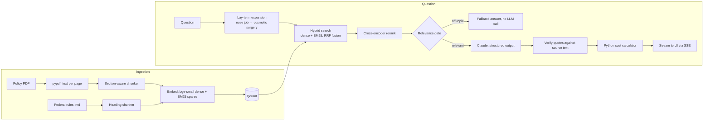

# Am I Covered?

**Ask your US health insurance policy a question in plain English. Get a verdict, the exact clause and page it comes from, the federal rules that protect you, and what to ask your insurer.**

People pay for health insurance and never read the 60-page policy. Then a claim is denied because of clause 7.3(b). *Am I Covered?* is a retrieval-augmented generation (RAG) app that reads the policy for you, and it's built so it **can't quietly make things up**: every policy quote is checked against the source text before you see it.

> "I broke my arm on vacation in Spain. Am I covered?"
>
> **COVERED, WITH CONDITIONS.** Emergency care abroad is covered at in-network rates, but you'll likely pay up front and claim it back.
> *"Emergency services and urgent care received outside the United States are covered at the In-Network level of benefits."* (Page 8, 5.3 Care Outside the United States)
> **Not covered:** medical evacuation home (7.10). **Ask your insurer:** where do I send foreign claims?

## What makes it different from "chat with a PDF"

| | |
|---|---|
| **Two knowledge sources** | Your policy *plus* a curated base of US federal rules (ACA preventive care, No Surprises Act, appeal rights, out-of-pocket limits, mental health parity). Answers keep "what your policy says" separate from "what federal law says". |
| **Verdicts, not essays** | Covered / Covered with conditions / Not covered / Unclear / Not in policy, enforced with structured output. |
| **Verified citations** | Every quote must actually appear in the cited excerpt (fuzzy-matched to survive PDF line breaks). Fabricated quotes are removed, and a "Covered" verdict with no surviving evidence is downgraded to "Unclear". |
| **Code does the math** | For "my MRI costs $1,800, what will I pay?", the LLM only identifies the cost rule (deductible? 30% coinsurance?). A unit-tested Python function computes the dollars. |
| **Knows when to say "I don't know"** | A relevance gate stops off-topic questions *before* the LLM is called. That's cheaper, and the model can't improvise from irrelevant text. |
| **Measured, not vibes** | A 34-question evaluation set with ground-truth pages and verdicts. Retrieval: **100% hit@6, MRR 0.95** (from 97% / 0.82 before query expansion). |

## Architecture



**Stack:** Python 3.12, FastAPI, Qdrant (embedded locally, Qdrant Cloud optional), fastembed (local ONNX models: `bge-small-en-v1.5`, BM25, `ms-marco-MiniLM` cross-encoder), Claude via the Anthropic SDK, React 19 + TypeScript + Vite. One Docker image serves both API and UI.

A step-by-step walkthrough of every component and design decision is in **[docs/HOW_IT_WORKS.md](docs/HOW_IT_WORKS.md)**.

## Run it locally

**Prerequisites:** Python 3.12+, Node 20+, and an [Anthropic API key](https://console.anthropic.com/).

```bash
# 1. Backend
cd backend
python -m venv .venv
.venv\Scripts\activate            # macOS/Linux: source .venv/bin/activate
pip install -r requirements-dev.txt
cp .env.example .env              # then paste your ANTHROPIC_API_KEY into .env
uvicorn app.main:app --reload     # http://localhost:8000
```

The first start downloads the embedding models (~200 MB, once) and indexes the federal rules and the sample policy. That takes about a minute; later restarts skip unchanged documents.

```bash
# 2. Frontend (second terminal)
cd frontend
npm install
npm run dev                       # http://localhost:5173 (proxies /api to :8000)
```

Without an API key the app still runs: you'll see which policy sections were retrieved, but no written answer.

## Tests and evaluation

```bash
cd backend
pytest -q                              # 86 tests, ~15 s, no network/API key needed
python eval/run_retrieval_eval.py      # retrieval quality, free (local models only)
python eval/run_answer_eval.py         # full pipeline with Claude, ~$1 for 34 questions
```

The tests use a fake embedder and a fake LLM client, so they're fast and deterministic, and CI runs them on every push. They cover the chunker, hybrid search, the relevance gate, citation verification (including fabricated quotes), the cost calculator (checked against the policy's own worked examples), rate limits, path-traversal-safe document IDs, and the full upload → ask flow through the HTTP API.

Retrieval eval on the sample policy:

| | hit@6 | MRR |
|---|---|---|
| Hybrid search + rerank | 97% | 0.82 |
| + lay-term query expansion | **100%** | **0.95** |

## API

| Method | Path | |
|---|---|---|
| `GET` | `/api/health` | liveness, and whether the LLM is configured |
| `GET` | `/api/documents/{id}` | document metadata and extracted plan facts |
| `GET` | `/api/documents/{id}/file` | the PDF (citations link to `#page=N`) |
| `POST` | `/api/documents` | upload a policy PDF (multipart, max 10 MB) |
| `POST` | `/api/ask` | `{question, doc_id}` → Server-Sent Events: `status`, `sources`, `answer` or `error`, `done` |

Interactive docs at `/docs` when the server is running.

## Deploy

One container serves everything. See **[docs/DEPLOY.md](docs/DEPLOY.md)** for Hugging Face Spaces (free) and other hosts.

```bash
docker build -t am-i-covered .
docker run -p 7860:7860 -e ANTHROPIC_API_KEY=sk-ant-... am-i-covered
```

## Safety and privacy

- Uploaded policies are deleted after 24 hours, and document IDs are validated so they can never escape the storage folder.
- Uploads are checked by their bytes (`%PDF-`), not by filename, and capped by size and page count.
- Per-IP rate limits and a global daily question budget protect the public demo and the API bill.
- Retrieved text is escaped and fenced in XML tags, and the model is told document text is data, not instructions. That's a defense against prompt injection hidden in uploaded PDFs.
- Not legal or medical advice; the UI says so and always suggests confirming with the insurer.

## Limitations and next steps

- **Scanned PDFs** need OCR, which isn't implemented yet. The app detects them and says so.
- **Federal rules only.** State mandates vary across 50 states, and self-funded employer (ERISA) plans are exempt from many of them. A state layer is the natural next step.
- **Single-turn questions.** Follow-ups ("what about out-of-network?") would need query rewriting with conversation history.
- **Tables.** Real SBC grids extract as loose lines; layout-aware parsing would improve them.
- **Scaling.** Rate limits are in memory (one instance). Several instances would move them to Redis and the vector index to Qdrant Cloud.

The sample "Evergreen Mutual Health" policy is **fictional**, generated by `backend/scripts/make_sample_policy.py`.
